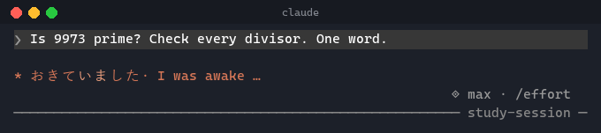
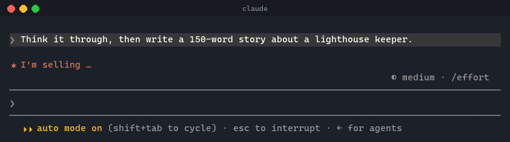
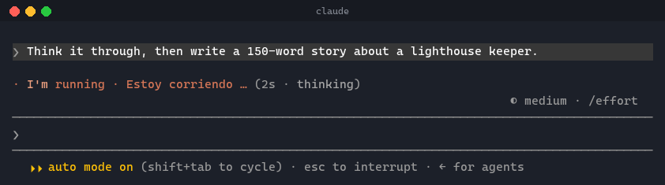
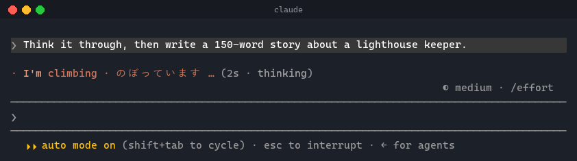
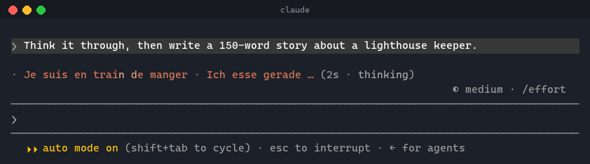
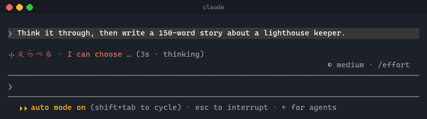

# claude-language-spinner

[](https://github.com/lucaslobasso/claude-language-spinner/actions/workflows/ci.yml)
[](CHANGELOG.md)
[](LICENSE)
[](#requirements)
[](#install)

Learn a language while Claude thinks. Claude Code's "thinking" spinner shows a phrase, then its translation five seconds later, and moves on to a different verb every twenty seconds while a long turn runs. Out of the box it is English then Spanish.

<p align="center">
  
</p>
<p align="center"><sub>Real Claude Code output, recorded with <code>rotate 2</code> to make the GIF short. The default is a new word every 20 seconds.</sub></p>

> Unofficial community project, not affiliated with Anthropic.

**[Requirements](#requirements) · [Install](#install) · [Settings](#settings) · [How it looks](#how-it-looks) · [Your own pack](#your-own-pack) · [Update](#update) · [Troubleshooting](#troubleshooting) · [Uninstall](#uninstall) · [Install the whole set](#install-the-whole-set)**

The phrases come from a **pack**:

- **Built in:** nine language pairs with the same 50 verbs ([details](#language-pairs)), and a Japanese pack that shows what a custom pack can do.
- **A JSON file:** a list of phrases you write or download. Starter packs for [Spanish](examples/spanish.json) and [French](examples/french.json) are in `examples/`.
- **A script:** any command that prints the list. It can read your study notes, pick the words you got wrong, or call an API.

## Requirements

- Claude Code **2.1.3xx or newer** (`claude --version`), which has the function-hook plugin API (early access; it may change between releases).
- Any OS and terminal. Script packs need whatever runs the script (Python, Node, ...); the plugin itself needs nothing else.

## Install

At the prompt of a Claude Code session:

```
/plugin install language-spinner --marketplace lucaslobasso/claude-language-spinner
```

Answer `y` to add the marketplace, then pick a scope (**user** = every project). Or from a shell:

```sh
claude plugin marketplace add lucaslobasso/claude-language-spinner
claude plugin install language-spinner@claude-language-spinner --scope user
```

The next time Claude thinks, the spinner shows English, then Spanish. To switch, see [Language pairs](#language-pairs); to learn something else, [Your own pack](#your-own-pack).

## Settings

Change them with `/spinner` commands or in `/config` under **language-spinner**:

| Setting | Default | Values | Command | What it does |
| --- | --- | --- | --- | --- |
| `enabled` | `true` | true / false | `/spinner on` · `off` | Phrases in the spinner, or Claude Code's own words |
| `pack` | `en-es` | a [language pair](#language-pairs), `japanese`, or [your own](#your-own-pack) | `/spinner pack NAME` | Where the phrases come from |
| `display` | `alternate` | `alternate` / `same-line` | `/spinner alternate` · `same-line` | The phrase, then its translation; or both on one line |
| `intervalSeconds` | `5` | whole seconds, 1+ | `/spinner interval 5` | How long each half stays up when alternating |
| `rotateSeconds` | `20` | whole seconds, `0` = one word per turn | `/spinner rotate 20` | When to move to a different word during a long turn |
| `separator` | ` · ` | text | `/config` | Between phrase and translation in same-line display |

### Commands

Everything is controlled from the prompt with `/spinner`. The settings are also rows in `/config`.

| Command | Does |
| --- | --- |
| `/spinner` | Show whether it's on, the current pack and the settings |
| `/spinner on` · `/spinner off` | Turn the phrases on or off (off = Claude Code's own spinner words) |
| `/spinner packs` | List packs (`*` marks the current one) |
| `/spinner pack NAME` | Switch to a pack |
| `/spinner add NAME --file PATH` | Add a pack from a JSON file |
| `/spinner add NAME CMD… [--cwd DIR]` | Add a pack that runs a command |
| `/spinner show NAME` | Show what a pack runs or reads |
| `/spinner test NAME` | Try a pack without switching to it: prints its size and first phrases, or why it failed |
| `/spinner refresh` | Load the current pack again (after you edit the file or your data changes) |
| `/spinner remove NAME` | Remove a pack you added |
| `/spinner alternate` · `/spinner same-line` | The phrase first, then its translation · or both together on one line |
| `/spinner interval 5` | Seconds each half stays up when alternating (whole seconds, 1 or more) |
| `/spinner rotate 20` | Switch to a different word after 20 seconds (`0` = one word per turn) |

Defaults: on, `en-es`, alternate display, a 5-second interval, a new verb every 20 seconds. In alternate display a word always stays for at least two intervals, so its translation gets its turn.

The spinner always moves to a different word, never to another form of the same one. Every word comes up once before any repeats, and a new turn or session never opens on the word the last one ended on.

## How it looks

| | |
| --- | --- |
| **`en-es`, alternate** (default; here `intervalSeconds=3`) | **`display=same-line`** |
|  |  |
| **`pack=en-jp`** (same-line) | **`pack=fr-de`** (same-line) |
|  |  |
| **`pack=japanese`** (same-line): five forms per verb | |
|  | |

<sub>Real Claude Code sessions captured offscreen while Claude was thinking (see [Contributing](#contributing)).</sub>

## Your own pack

A pack is a JSON list of phrases:

```json
[
  { "text": "estoy comiendo", "gloss": "I'm eating", "verb": "comer" },
  { "text": "quiero comer",   "gloss": "I want to eat", "verb": "comer" },
  { "text": "estoy durmiendo", "gloss": "I'm sleeping", "verb": "dormir" }
]
```

- `text`: the phrase in your language. `gloss`: its translation.
- `verb` (optional): rows that share it are forms of one word, so the spinner never jumps between them. Rows without `verb` each count as their own word.
- Rows missing `text` or `gloss` are ignored. Save or print it as UTF-8.

### From a file

The easiest way. Download [examples/spanish.json](examples/spanish.json) (or write your own), then:

```
/spinner add spanish --file C:\packs\spanish.json
/spinner test spanish
/spinner pack spanish
```

Use the **full path** to the file: a relative one is looked up from wherever you started Claude Code.

### From a script

Any command that prints the list works, in any language. See [examples/pack.py](examples/pack.py) and [examples/pack.mjs](examples/pack.mjs).

```
/spinner add spanish py C:\packs\pack.py              (Windows: "py" is the Python launcher)
/spinner add spanish python3 ~/packs/pack.py          (macOS, Linux)
/spinner add spanish node C:\packs\pack.mjs           (Node, which npm installs of Claude Code already have)
```

- Use `--cwd DIR` (right after the name, or at the end) to run the command from a folder, for example a repository your script reads.
- Put quotes around a path with spaces.
- On Windows, `python3` is often a Microsoft Store shortcut that prints nothing, and `python` may not be on your `PATH`. `py` is the safest choice.
- PowerShell and `cmd` scripts don't print UTF-8 by default, so non-English text can come out garbled. Prefer Python or Node, or set the output encoding to UTF-8 in your script.

When Claude Code starts, the current pack's command runs in the background. Its last good list shows straight away, so a slow script never holds anything up. If a command fails, times out (15 seconds) or prints nothing usable, you get one notice saying why, and the last good list stays. If there is none yet, the default `en-es` pack is used. Run `/spinner refresh` after your data changes.

## Language pairs

Nine built-in packs, named `from-to`. The first language shows first and the second is its translation 5 seconds later, so `en-es` shows English, then Spanish. Switch with `/spinner pack NAME`.

| Pack | Shows → then | Pack | Shows → then |
| --- | --- | --- | --- |
| `en-es` (default) | English → Spanish | `fr-jp` | French → Japanese |
| `en-fr` | English → French | `de-es` | German → Spanish |
| `en-de` | English → German | `de-jp` | German → Japanese |
| `en-jp` | English → Japanese | `fr-de` | French → German |
| `fr-es` | French → Spanish | | |

Every pack has the same 50 everyday verbs, always in the first person and continuous: "I'm eating", "Estoy comiendo", "Je suis en train de manger", "Ich esse gerade", "たべています". French and German have no continuous tense, so they use the usual stand-ins (*être en train de*, *gerade*). Japanese is in hiragana. The table is in [`hooks/packs/verbs.ts`](hooks/packs/verbs.ts). The phrases were written without a native review, so corrections are welcome.

## The Japanese pack

The `japanese` pack is not part of the pairs: it is a separate file, [`hooks/packs/japanese.ts`](hooks/packs/japanese.ts), that shows what a custom pack can be. It has the same 50 verbs and adds the tenses, in hiragana, each in five forms: progressive (ている), past progressive, let's (volitional), want to (たい) and can (potential). A verb of arriving or changing state (行く, 来る, 帰る) can carry a note on what its ている form means, so いっている reads "I've gone (I'm there)", not "I'm going"; none of the 50 needs one. The verb list and conjugation rules are in the same file. Copy it to start your own, or keep yours outside the plugin as a [script pack](#from-a-script).

## Update

```
claude plugin marketplace update claude-language-spinner
claude plugin update language-spinner@claude-language-spinner
```

Third-party marketplaces don't update on their own unless you turn that on in `/plugin` → **Marketplaces**. See [CHANGELOG.md](CHANGELOG.md).

## How it works

The plugin replaces the words of Claude Code's spinner (`ui.render` for the spinner row) with the current pack's phrases. Built-in packs are code in `hooks/packs/`; file and script packs are read or run in the background when a session starts, and their last good list is cached, so a slow or failing script never holds anything up. Timers pick the next word while a turn runs.

## Troubleshooting

- **Still Claude's own words.** Run `/spinner` to check that it's on and see how many phrases the pack has. The spinner only changes while Claude is working, and an engine message such as "Compacting" is always left as it is.
- **"pack … failed: "py" was not found".** The command isn't on your `PATH` as seen by Claude Code. Use the full path to the interpreter, or try `py` / `python3` / `node`.
- **"its output is not a list of phrases".** Run your script in a terminal: it must print only the JSON list, nothing before or after it.
- **The same words every time.** That's the pack's last good list (the cache). Run `/spinner refresh`, or `/spinner test NAME` to see the current error.
- **Garbled accents or CJK.** The script printed in another encoding; see the notes under [From a script](#from-a-script).

## Uninstall

```sh
claude plugin uninstall language-spinner@claude-language-spinner
claude plugin marketplace remove claude-language-spinner
```

<!-- bundle:start (copied from claude-launcher/docs/bundle-section.md; edit it there and copy to all six READMEs) -->
## Install the whole set

This is one of six small tools that work well together. Each installs on its own, or get them all with one command:

| Tool | What it does | Runs on |
| --- | --- | --- |
| [Claude Launcher](https://github.com/lucaslobasso/claude-launcher) | One click from the taskbar or Start menu straight into Claude Code, with a Claude icon and a loading spinner | Windows |
| [Claude Taskbar](https://github.com/lucaslobasso/claude-taskbar) | Your Claude sessions and usage limits as dots and bars on the Windows taskbar | Windows |
| [boxed-messages](https://github.com/lucaslobasso/claude-boxed-messages) | Colored boxes around your prompts and Claude's replies | Any |
| [claude-statusline](https://github.com/lucaslobasso/claude-statusline) | A status line with model, context, branch, and usage only when it gets high | Any |
| [claude-sessions](https://github.com/lucaslobasso/claude-sessions) | limit-revive resumes unfinished work after the 5-hour or weekly limit resets, context-handoff continues in a fresh session before the context fills, subagentify splits planned work across Opus and Sonnet subagents | Any |
| [language-spinner](https://github.com/lucaslobasso/claude-language-spinner) | The "thinking" spinner shows words in a language you are learning | Any |

**Windows** (PowerShell 7):

```powershell
irm https://raw.githubusercontent.com/lucaslobasso/claude-launcher/main/bundle.ps1 | iex
```

To pick, pass options: `-Only statusline,limit-revive`, `-Skip launcher`, `-List` (show what is installed) or `-Uninstall`:

```powershell
& ([scriptblock]::Create((irm https://raw.githubusercontent.com/lucaslobasso/claude-launcher/main/bundle.ps1))) -Skip taskbar
```

**macOS and Linux:** the plugins work everywhere. In a shell:

```sh
for p in boxed-messages statusline language-spinner; do
  claude plugin marketplace add "lucaslobasso/claude-$p"
  claude plugin install "$p@claude-$p" --scope user
done
claude plugin marketplace add lucaslobasso/claude-sessions
for p in limit-revive context-handoff subagentify; do
  claude plugin install "$p@claude-sessions" --scope user
done
```
<!-- bundle:end -->

## Contributing

```
git clone https://github.com/lucaslobasso/claude-language-spinner
cd claude-language-spinner
claude --plugin-dir .            # try your changes in a session
claude plugin test .             # tests (tests/*.test.tsx)
claude plugin validate .
```

**A new built-in pack** is a function returning the list (`{ text, gloss, verb? }[]`), registered by name in `BUILTINS` in `hooks/register.tsx`. A new language pair is one more line in `PAIRS` (`hooks/packs/pairs.ts`) once its phrases are in the table in `verbs.ts`; see `japanese.ts` for a pack that conjugates verbs. Pull requests are welcome, especially from native speakers.

`python docs/screenshots.py` retakes the screenshots offscreen with the capture script shared by the set (claude-boxed-messages `docs/capture.py`; `pip install pyte pillow pywinpty`). The GIF is made the same way with `capture.py --frames 40 --every 250` and `rotate 2`.

## License

[MIT](LICENSE) © Lucas Lobasso
